 

 

I'm a Machine Learning Engineer with a Mechatronics background. I build the systems beneath a useful interface: models, data pipelines, and the decisions they support.

<table align="center">
<tr>
<td align="center" width="50%">

**Currently**
Machine Learning Intern at **FlyRank AI** (Remote)

</td>
<td align="center" width="50%">

**Building**
**[Movenue](https://www.movenue.online/)**, a two-sided court-booking platform live in production

</td>
</tr>
</table>

---

## Selected Work

<table>
<tr>
<td width="50%" valign="top">

### [Movenue](https://www.movenue.online/)
Two-sided marketplace for padel and football courts in Egypt. Full Arabic/English localization and a booking engine built for concurrent double-booking.

  

</td>
<td width="50%" valign="top">

### [Agri-Bot](https://github.com/Yousef-koura/AGRI-BOT)
Graduation project: AI-powered crop disease detection robot. Published at IUGRC 2024.

  

</td>
</tr>
<tr>
<td width="50%" valign="top">

### [PneumoScan](https://yousefkoura.vercel.app/)
Chest X-ray pneumonia classifier, benchmarked against ResNet-18 on 5,863 images. Served via FastAPI behind a React frontend.

  

</td>
<td width="50%" valign="top">

### [Personal RAG Chatbot](https://yousefkoura.vercel.app/)
Natural-language Q&A over a personal knowledge base, using Llama 4 Scout via Groq.

  

</td>
</tr>
<tr>
<td width="50%" valign="top">

### [FMCG Data Engineering](https://yousefkoura.vercel.app/)
End-to-end Lakehouse consolidation for an FMCG retailer's acquisition, built as a Medallion Architecture with star schema modeling.

  

</td>
<td width="50%" valign="top">

### [Deep Learning Projects](https://github.com/Yousef-koura/Deep_Learning_Projects)
Potato-leaf disease detection served as a full-stack app, plus a CNN classifier for hidden-data detection in images.

 

</td>
</tr>
</table>

---

## Experience

- **Machine Learning Intern**, FlyRank AI (Remote), *current*
- **Machine Learning Intern**, PioPetro
- **Machine Learning Intern**, ITI and Digital HUB (D-HUB), 3rd place, ERI challenge

**Education:** B.Sc. Mechatronics Systems Engineering, MSA University, Egypt, in partnership with the University of Greenwich, UK.
**Certifications:** ML Specialization (DeepLearning.AI), containerization (IBM).

---

## Toolkit

---

## Code Activity

---

**Based in Menoufia, Egypt.** Open to Junior ML Engineer, AI Engineer, and Computer Vision roles.

 

 

